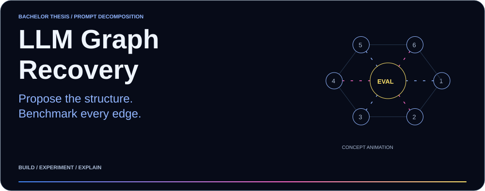
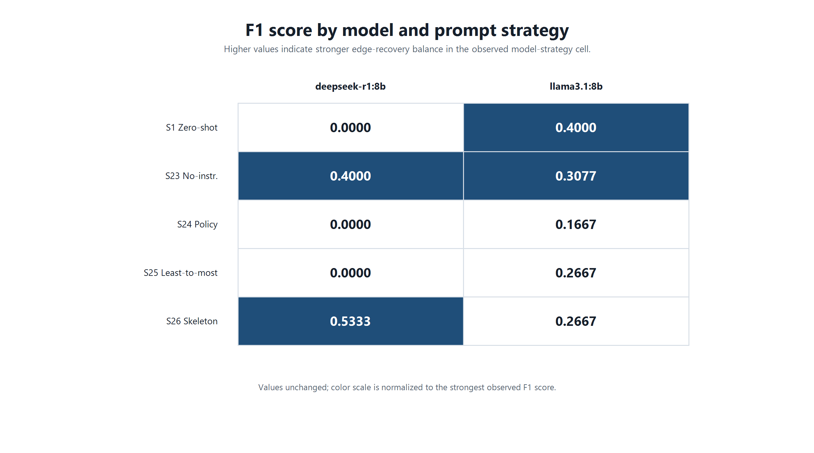
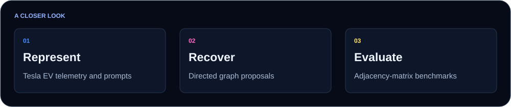
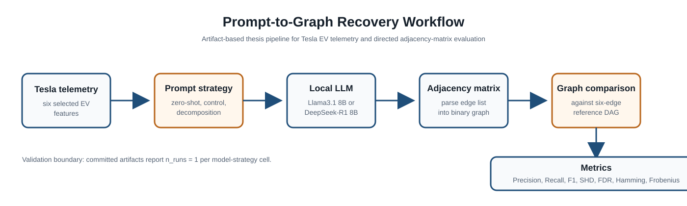
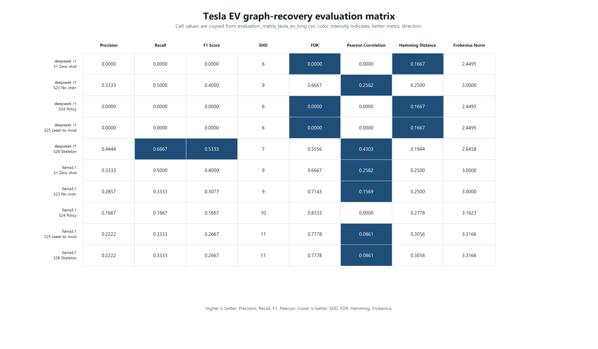
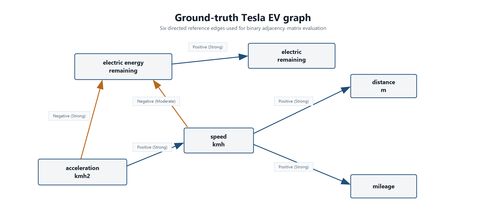

<picture>
  <source media="(max-width: 600px)" srcset="docs/readme/hero-mobile.svg">
  
</picture>

<p align="center"><a href="REPRODUCIBILITY.md"><b>Reproduce ↗</b></a> &nbsp; · &nbsp; <a href="#results-at-a-glance"><b>Results ↗</b></a> &nbsp; · &nbsp; <a href="CITATION.cff"><b>Citation ↗</b></a></p>

My bachelor thesis explores whether language models can recover relationships between vehicle telemetry signals, and how much the prompting strategy changes the result.

I compared **Llama 3.1 8B and DeepSeek-R1 8B** across five prompting strategies on **65,261 Tesla EV telemetry records**. This repository contains the thesis, prompts, recorded model outputs and scripts used to check the proposed graphs.

## Results at a glance

| Focus | What this repository contains |
| :--- | :--- |
| **2 models × 5 strategies** | Ten model and prompting combinations. |
| **Best observed F1** | 0.5333 — DeepSeek-R1 with skeleton-of-thought. |
| **Exploratory scope** | One recorded output per setting; repeated-run stability and causal discovery are not established. |

## Project preview



## How the pieces fit

<picture>
  <source media="(max-width: 600px)" srcset="docs/readme/workflow-mobile.svg">
  
</picture>

## Getting started

<details>
<summary><b>Open setup, execution and configuration instructions</b></summary>

## Commands

### Compile the Thesis

```bash
make thesis
```

Equivalent generic LaTeX commands:

```bash
pdflatex -interaction=nonstopmode main.tex
biber main
pdflatex -interaction=nonstopmode main.tex
pdflatex -interaction=nonstopmode main.tex
```

On the Windows MiKTeX setup used for local validation:

```powershell
& "$env:LOCALAPPDATA\Programs\MiKTeX\miktex\bin\x64\miktex-pdftex.exe" "&pdflatex" -interaction=nonstopmode main.tex
& "$env:LOCALAPPDATA\Programs\MiKTeX\executables\windows-x64\biber\biber.exe" main
& "$env:LOCALAPPDATA\Programs\MiKTeX\miktex\bin\x64\miktex-pdftex.exe" "&pdflatex" -interaction=nonstopmode main.tex
& "$env:LOCALAPPDATA\Programs\MiKTeX\miktex\bin\x64\miktex-pdftex.exe" "&pdflatex" -interaction=nonstopmode main.tex
```

### Validate Artifacts

```bash
make validate
python scripts/validate_artifacts.py
```

### Regenerate Figures

```bash
make figures
```

PowerShell equivalent:

```powershell
powershell -ExecutionPolicy Bypass -File scripts\generate_graph_recovery_figures.ps1
```

### Clean Build Files

```bash
make clean
```

</details>

## Technical reference

<details>
<summary><b>Methods and implementation</b></summary>

# Prompt Decomposition Strategies for Reliable Telematics-Based Fleet Monitoring Using Llama3 and DeepSeek

Bachelor thesis repository for an artifact-based evaluation of prompt decomposition strategies for LLM-assisted graph recovery from Tesla EV telemetry.



## Workflow

```text
Tesla EV telemetry
  -> feature selection and dataset fingerprint
  -> prompt strategy
  -> local LLM generation
  -> directed edge parsing
  -> predicted adjacency matrix
  -> comparison with six-edge reference graph
  -> Precision, Recall, F1, SHD, FDR, Hamming Distance, Frobenius Norm
```

## Prompting Strategies

| Strategy | Role |
| --- | --- |
| `Strategy_1_Zero_Shot_Prompting` | Direct graph-recovery baseline. |
| `Strategy_23_No_Instruction_Control` | Minimal-instruction control. |
| `Strategy_24_Policy_First_Structured` | Structured constraints before graph output. |
| `Strategy_25_Least_to_Most` | Ordered decomposition from simpler relations to accumulated-state relations. |
| `Strategy_26_Skeleton_of_Thought` | Decomposition by energy-state, driving-behavior, cross-group, and integrity checks. |

</details>

<details>
<summary><b>Results and interpretation</b></summary>

## Key Findings

- Best observed cell: `deepseek-r1:8b` with `Strategy_26_Skeleton_of_Thought`, with F1 = `0.5333`, precision = `0.4444`, recall = `0.6667`, and SHD = `7`.
- Skeleton-of-thought prompting indicates the strongest decomposition result in the validated artifact set, but it still produces false positives.
- Llama3.1 8B produces non-empty graphs in all five evaluated strategies, while DeepSeek-R1 8B has three zero-edge cells.
- Consensus edges reveal both recurring true structure and recurring direction errors, especially speed/acceleration and mileage/distance reversals.
- The evidence suggests that LLMs are useful as graph proposal systems, not as standalone causal-discovery systems.

## Result Visualizations

### Evaluation Matrix



### F1 by Model and Strategy


### Ground-Truth Graph



## Results Summary

Primary source: `results/tesla_ev_graph_recovery/evaluation_matrix_tesla_ev.csv`.

| Model | Strategy | Precision | Recall | F1 | SHD | FDR | Hamming | Frobenius |
| --- | --- | ---: | ---: | ---: | ---: | ---: | ---: | ---: |
| DeepSeek-R1 8B | Zero-shot | 0.0000 | 0.0000 | 0.0000 | 6 | 0.0000 | 0.1667 | 2.4495 |
| DeepSeek-R1 8B | No-instruction control | 0.3333 | 0.5000 | 0.4000 | 9 | 0.6667 | 0.2500 | 3.0000 |
| DeepSeek-R1 8B | Policy-first structured | 0.0000 | 0.0000 | 0.0000 | 6 | 0.0000 | 0.1667 | 2.4495 |
| DeepSeek-R1 8B | Least-to-most | 0.0000 | 0.0000 | 0.0000 | 6 | 0.0000 | 0.1667 | 2.4495 |
| DeepSeek-R1 8B | Skeleton-of-thought | **0.4444** | **0.6667** | **0.5333** | 7 | 0.5556 | 0.1944 | 2.6458 |
| Llama3.1 8B | Zero-shot | 0.3333 | 0.5000 | 0.4000 | 9 | 0.6667 | 0.2500 | 3.0000 |
| Llama3.1 8B | No-instruction control | 0.2857 | 0.3333 | 0.3077 | 9 | 0.7143 | 0.2500 | 3.0000 |
| Llama3.1 8B | Policy-first structured | 0.1667 | 0.1667 | 0.1667 | 10 | 0.8333 | 0.2778 | 3.1623 |
| Llama3.1 8B | Least-to-most | 0.2222 | 0.3333 | 0.2667 | 11 | 0.7778 | 0.3056 | 3.3166 |
| Llama3.1 8B | Skeleton-of-thought | 0.2222 | 0.3333 | 0.2667 | 11 | 0.7778 | 0.3056 | 3.3166 |

## Reproducibility Boundary

The repository separates three tasks:

- Artifact validation: `python scripts/validate_artifacts.py`
- Figure regeneration: `powershell -ExecutionPolicy Bypass -File scripts\generate_graph_recovery_figures.ps1`
- Optional experiment rerun: open `notebooks/tesla_graph_recovery_llama3_deepseek.ipynb` with local Ollama models available

The notebook documents the experiment source, but a full rerun can produce different individual generations. New reruns should be stored separately and compared against the committed artifact set before replacing thesis results.

## Limitations

This is an exploratory, artifact-based thesis evaluation. The observed results use one Tesla EV dataset, two local 8B-class models, five prompt strategies, and one validated output per model-strategy cell. The graph reference is physics-informed and useful for benchmarking, but it is not an interventionally identified causal graph. The results suggest that prompt decomposition can improve graph proposals in this setting; they do not establish repeated-run stability, broad generality, or standalone causal discovery.

</details>

<details>
<summary><b>Project context and reference</b></summary>

## Project Status

Current thesis version: graph recovery / prompt decomposition.

This repository is intentionally separate from the earlier thesis repository and contains the LaTeX source, Tesla EV dataset copy, configuration, validated result artifacts, figures, and reproducibility scripts for the current thesis scope.

The result set is fixed and artifact-based. Each validated model-strategy cell reports `n_runs = 1`, so the findings should be read as observed exploratory results rather than repeated-run estimates.

## Research Question

How do prompt decomposition strategies affect the reliability of LLM-assisted graph recovery from vehicle telematics data, compared with simpler prompting baselines, when outputs are evaluated as directed adjacency matrices?

## Experimental Environment

| Component | Recorded value |
| --- | --- |
| Dataset | Tesla EV telemetry, `data/tesla.csv` |
| Rows recorded in config | 65,261 |
| Selected features | `electricenergyremaining`, `electricremaining`, `speed_kmh`, `acceleration_kmh2`, `mileage`, `distance_m` |
| Runtime | Ollama local generation endpoint |
| Models | `llama3.1:8b`, `deepseek-r1:8b` |
| Temperature | `0.2` |
| Top-p | `0.9` |
| Context length | `8192` |
| Validated runs per cell | `1` |

Configuration source: `configs/graph_recovery_config.json`.

## Repository Structure

```text
.
|-- .github/workflows/              # CI for LaTeX and artifact validation
|-- appendix/                       # Thesis appendix source
|-- chapters/                       # Thesis chapters
|-- configs/                        # Experiment configuration
|-- data/                           # Tesla EV telemetry dataset copy
|-- docs/                           # Repository-level visual documentation
|-- figures/                        # Figures referenced by README and thesis
|-- notebooks/                      # Experiment notebook artifact
|-- results/tesla_ev_graph_recovery # Validated graph-recovery artifacts
|-- scripts/                        # Validation and figure-generation scripts
|-- main.tex                        # LaTeX thesis entry point
|-- references.bib                  # Bibliography
|-- REPRODUCIBILITY.md              # Reproducibility guide
|-- CITATION.cff                    # Citation metadata
|-- LICENSE
|-- Makefile
`-- README.md
```

## Citation

Use the metadata in `CITATION.cff`, or cite the thesis repository as:

```bibtex
@thesis{bakkoury2026prompt,
  title  = {Prompt Decomposition Strategies for Reliable Telematics-Based Fleet Monitoring Using Llama3 and DeepSeek},
  author = {Bakkoury, Anas},
  school = {Constructor University},
  type   = {Bachelor Thesis},
  year   = {2026},
  url    = {https://github.com/bakk0u/llm-telematics-graph-recovery-thesis}
}
```

</details>

